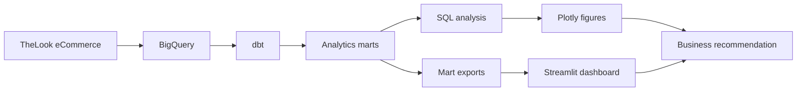
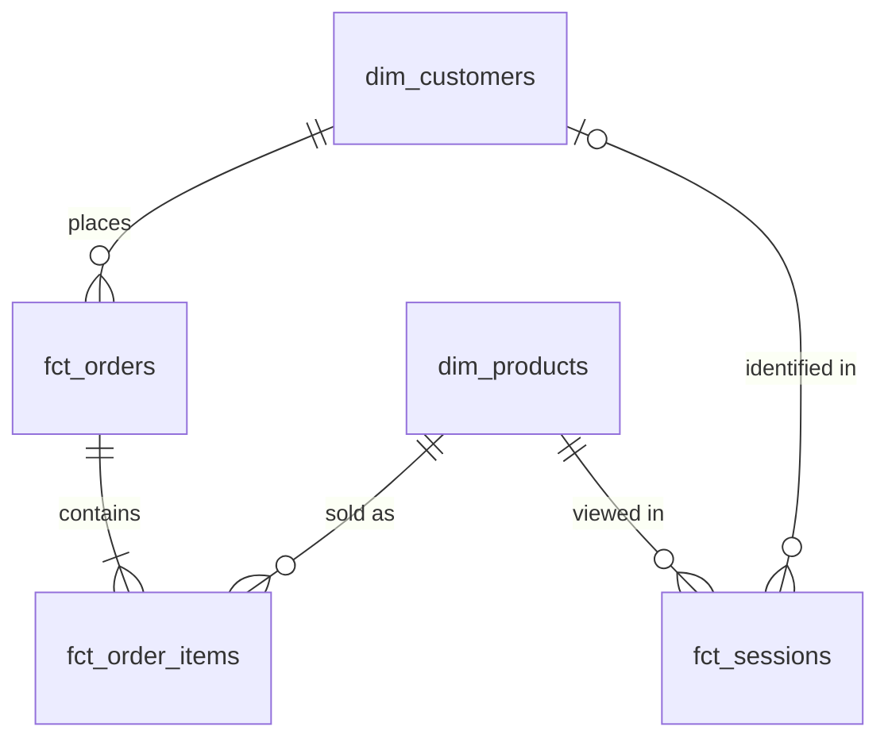

# E-commerce Customer & Revenue Analytics

An end-to-end analysis of an online apparel retailer's orders, customers and web sessions, built on Google's public TheLook eCommerce dataset with BigQuery, dbt, SQL and a Streamlit dashboard.

## Business Problem

Where is e-commerce revenue being lost, which customer segments represent the largest opportunity to increase repeat revenue, and what actions should the business prioritize?

The data covers 124,814 orders from 100,000 registered users between January 2019 and September 2026, with 2.4 million web events. TheLook is a synthetic dataset; the limitations that follow from that are listed at the end.

## Key Findings

All figures are calculated from the data. Detail and sources are in [analysis/findings.md](analysis/findings.md).

- **24.7% of gross order value is lost to cancellations (15.1%) and returns (9.6%)**: $1,085,610 in the trailing 12 months against $3,306,214 of revenue. The rates barely move by year or by product category.
- **69.9% of customers have bought once.** The 30.1% who returned generate 50.4% of revenue at the same $86 average order value.
- **Repeat orders are slow**: the median gap between a customer's orders is 240 days.
- **Revenue is moderately concentrated**: the top 20% of customers account for 52.5% of revenue, not 80%.
- **Recency predicts a reorder; past spend does not.** In a 12-month backtest the reorder rate fell from 23.1% (last order within 90 days) to 11.4% (over two years ago), while high and low past spenders reordered at 16.8% and 15.7% with the same order value ($86).
- **The funnel loses 37% of sessions before cart and 58% of carts before purchase** (all time), with no difference between traffic sources, browsers or categories.


## Business Recommendation

1. Run a second-purchase program for one-time buyers, selected by recency and not by past spend. Start with the 18,636 whose only order was in the last 365 days, and reach new buyers within 90 days of their first order.
2. Measure the lift with a control group before scaling.
3. Start recording why orders are cancelled and returned. It is the largest loss in the data and cannot currently be diagnosed.

The lapsed high-spend segment that an RFM table would usually point to holds 24.9% of historical revenue, but the backtest shows those customers are no more likely to return and spend no more when they do. The full argument is in [docs/executive_summary.md](docs/executive_summary.md).

## Analytics Architecture



dbt builds staging, intermediate and mart layers in BigQuery. Analysis queries read only the marts. The figures and the dashboard read exported query results and mart tables and contain no transformation logic of their own. See [docs/architecture.md](docs/architecture.md).

## Data Model



| Model | Grain |
|---|---|
| `fct_orders` | One row per order |
| `fct_order_items` | One row per order item (one unit) |
| `fct_sessions` | One row per web session |
| `dim_customers` | One row per registered user |
| `dim_products` | One row per product |

Eight reporting marts sit on top of these: monthly revenue, cohort retention, RFM, revenue concentration, funnel summary, category metrics, a reorder backtest and the opportunity scenarios. The project has 21 models, one seed and 96 data tests, including a test that revenue is identical at item, order, customer, month and category grain.

## KPI Definitions

Complete, Shipped and Processing orders count toward revenue. Cancelled and Returned orders do not. The rule is defined once in a dbt macro and used everywhere. A customer is a user with at least one such order. All metric definitions, with SQL logic, grain and assumptions, are in [analysis/kpi_dictionary.md](analysis/kpi_dictionary.md).

## Customer & Retention Analysis

Customers are assigned to the month of their first valid order. Monthly retention is in the low single digits and flat within a cohort. The share of a cohort placing a second order within a year rises from 8.3% (2019) to 22.5% (2025), though part of that reflects how the dataset concentrates orders near its end date.


RFM scores use quintiles for recency and monetary value and the raw order count for frequency, since no customer has more than four orders. Seven segments are defined; High-Value At Risk and Champions each hold about a quarter of historical revenue.

## Funnel Analysis

The events support a product view, add to cart, purchase funnel measured per session. Conversion is flat across every available dimension. The gap between all-time and recent conversion is a mix effect: anonymous sessions, which never purchase, are constant over time while purchasing sessions grow.


## Revenue Opportunity

These are scenario estimates built on an assumed lift. They are not realized revenue.

Estimated incremental revenue = eligible one-time buyers (46,097, observed) x baseline 12-month reorder rate (15.4%, observed) x relative lift (assumed) x expected order value ($86.34, observed).

| Scenario | Assumed relative lift | Estimated incremental revenue, 12 months |
|---|---|---|
| Conservative | 5% | $30,622 |
| Base | 10% | $61,245 |
| Optimistic | 20% | $122,489 |

September 2026 has far more orders than any earlier month, so the baseline is measured over a window that ends on 2026-08-31. Including September changes the estimates by less than 1% ($30,840, $61,681 and $123,361) and does not change the conclusion. The comparison is in [analysis/findings.md](analysis/findings.md#7-sensitivity-to-the-september-2026-spike).

Assumptions are in [dbt_project/seeds/scenario_assumptions.csv](dbt_project/seeds/scenario_assumptions.csv); changing them and rebuilding recalculates the scenarios.

## Dashboard and Visualizations

An interactive Streamlit dashboard with four pages reads the mart exports in [data/marts/](data/marts) and needs no database connection:

| Page | Contents |
|---|---|
| Executive Overview | Revenue, orders, customers, AOV, repeat purchase rate, monthly revenue by new and returning customers, order value by status; date filter |
| Customer & Retention | Cohort retention heatmap, RFM segments, revenue concentration, orders per customer |
| Funnel & Product Performance | Session funnel with stage conversion and drop-off, conversion by segment, category performance; month, traffic source, browser and department filters |
| Revenue Opportunity | Eligible one-time buyers, observed baseline reorder rates, adjustable lift assumptions, conservative, base and optimistic estimates, recommended action |

```bash
streamlit run dashboard/app.py
```

Thirteen static Plotly figures, one per analytical question, are in [images/](images) as PNG and [figures/html/](figures/html) as interactive HTML.

## Tech Stack

- Google BigQuery (public dataset `bigquery-public-data.thelook_ecommerce`)
- dbt Core with the BigQuery adapter
- SQL
- Python: pandas, Plotly, Streamlit

## Repository Structure

```
.
├── README.md
├── requirements.txt
├── dbt_project/
│   ├── models/            staging, intermediate, marts
│   ├── macros/            revenue rule, recency bands
│   ├── seeds/             scenario assumptions
│   └── tests/             singular data tests
├── sql/
│   ├── profiling/         source data profiling queries
│   └── analysis/          analysis queries against the marts
├── scripts/               query runner and mart export
├── data/marts/            mart exports read by the dashboard and figures
├── analysis/
│   ├── findings.md
│   ├── kpi_dictionary.md
│   ├── data_quality.md
│   └── outputs/           one CSV per query
├── dashboard/             Streamlit app
├── figures/
│   ├── make_figures.py
│   └── html/
├── images/                PNG figures
└── docs/
    ├── executive_summary.md
    ├── architecture.md
    └── interview_guide.md
```

## Reproducing the Analysis

The dashboard and figures run from the committed CSVs and need only Python 3.10+:

```bash
python -m venv .venv && source .venv/bin/activate
pip install -r requirements.txt
streamlit run dashboard/app.py
python figures/make_figures.py   # PNG export also needs Chrome installed
```

Rebuilding from the source needs the Google Cloud CLI and a Google Cloud project with BigQuery enabled (the free sandbox is enough):

```bash
gcloud auth application-default login
export GCP_PROJECT_ID=your-project-id

cd dbt_project
cp profiles.example.yml profiles.yml
dbt build --profiles-dir .
cd ..

python scripts/run_sql.py
python scripts/export_marts.py
python figures/make_figures.py
```

TheLook is regenerated daily, so a rebuild produces different numbers from those documented here, which describe the snapshot of 2026-09-30. The committed CSVs in `analysis/outputs` and `data/marts` are that snapshot.

## Limitations

- The dataset is synthetic. Behavior is uniform across channels, categories and countries in ways real data would not be.
- Order volume is concentrated near the end of the data. The reorder baseline excludes the final month for this reason; recent-cohort retention and trailing-12-month totals still include it.
- The opportunity scenarios rest on an assumed lift. No campaign or experiment data exists to validate it.
- Revenue includes Processing and Shipped orders, some of which may later be cancelled or returned.
- There is no cost, discount, or cancellation and return reason data.
- Purchase sessions correspond to order items, not orders, and identified sessions always convert, so the funnel cannot be split by customer type or reconciled to orders.
- The recommendations are what the analysis suggests. Nothing was implemented or tested in a real business.

Data quality observations are documented in [analysis/data_quality.md](analysis/data_quality.md).
