# Findings

Business question: where is e-commerce revenue being lost, which customer segments represent the largest opportunity to increase repeat revenue, and what should the business prioritize?

Every figure below is an observed result from the query outputs in `analysis/outputs` unless it is labeled as an estimate. Data covers orders from 2019-01-11 to 2026-09-30. "Trailing 12 months" is 2025-10-01 to 2026-09-30. Metric definitions are in `kpi_dictionary.md`; data caveats are in `data_quality.md`.

## 1. Headline numbers

Source: `01_headline_kpis.csv`

| | All time | Trailing 12 months |
|---|---|---|
| Orders placed | 124,814 | 50,696 |
| Valid orders | 93,250 | 38,000 |
| Customers | 65,969 | 30,445 |
| Gross order value | $10,737,626 | $4,391,824 |
| Revenue | $8,046,468 | $3,306,214 |
| Average order value | $86.29 | $87.01 |
| Items per order | 1.45 | 1.46 |
| Returning-customer share of revenue | 29.1% | 37.9% |

Average order value has stayed between $84.88 and $88.18 in every year (`03_yearly_trend.csv`). Growth has come from order volume, not basket size.

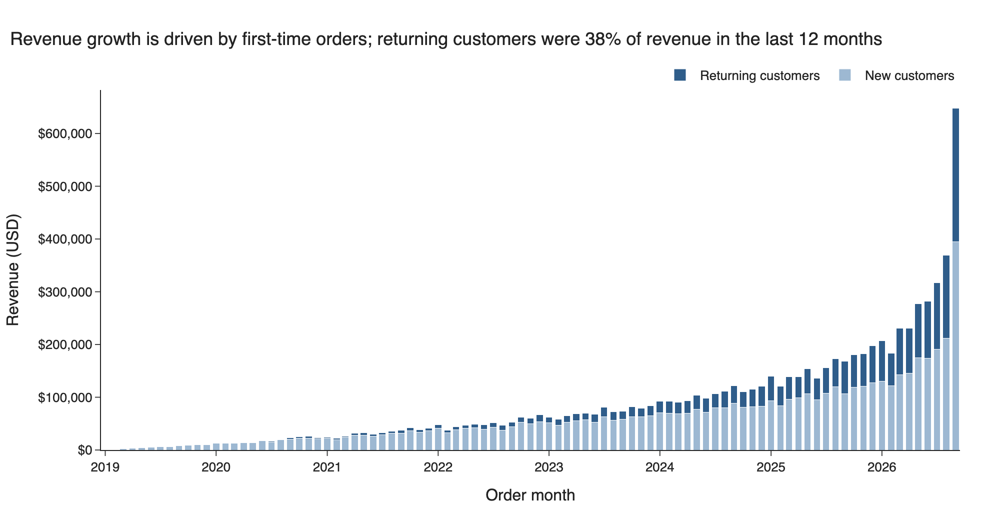

September 2026 revenue ($648,326) is 76% above August ($368,849). This reflects how the synthetic data concentrates orders near its end date and should not be read as a seasonal or commercial event.

## 2. Where revenue is lost

### Cancellations and returns

Source: `02_revenue_leakage_by_status.csv`, `24_cancellation_sensitivity.csv`

In the trailing 12 months, $663,035 of gross order value was cancelled (15.1%) and $422,575 was returned (9.6%). Together that is $1,085,610, or 24.7% of the value customers tried to buy. The all-time shares are almost the same: 15.1% cancelled and 9.9% returned, $2,691,159 in total.

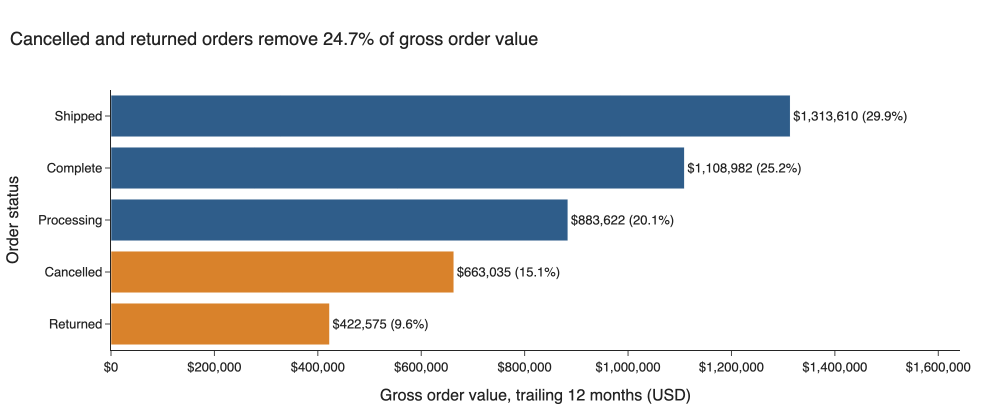

This is the largest single loss in the data, and it is uniform. By year, the cancelled share ranges from 14.6% to 16.8% and the returned share from 9.6% to 10.9%. Across the 26 product categories, unit cancellation rates range from 13.9% to 17.8% and return rates from 7.2% to 11.3%, with the extremes belonging to the two smallest categories. No category, period or channel stands out as the cause, and the source has no cancellation or return reason.

### The funnel

Source: `13_funnel_overall.csv`, `14_funnel_by_segment.csv`, `15_funnel_by_category.csv`, `16_funnel_by_year.csv`

The event data supports a three-stage funnel: product view, add to cart, purchase. Every session contains a product view, so "session" and "product view" are the same count. A `home` and `department` page exist but are not required steps, and `cancel` is an exit event rather than a stage.

| Stage | All-time sessions | Stage conversion | Trailing-12-month sessions | Stage conversion |
|---|---|---|---|---|
| Product view | 678,928 | | 135,772 | |
| Add to cart | 428,555 | 63.1% | 103,830 | 76.5% |
| Purchase | 178,928 | 41.8% | 71,879 | 69.2% |
| Overall conversion | | 26.4% | | 52.9% |

All-time, 250,373 sessions leave before adding to cart and 249,627 add to cart without purchasing. Of the abandoned carts, 124,707 end with an explicit `cancel` event.

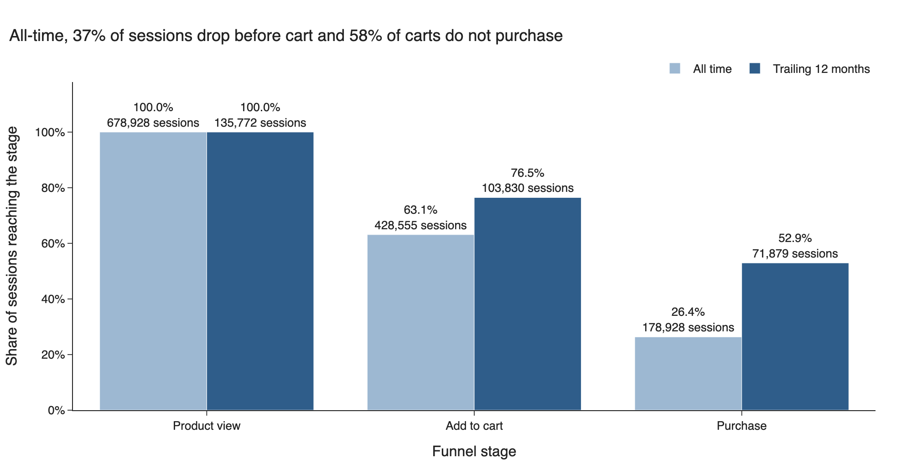

Three properties of the event data limit what the funnel can say:

- Conversion does not vary by segment. In the trailing 12 months, overall conversion ranges from 52.7% to 54.7% across browsers, 52.8% to 53.3% across traffic sources, and 51.8% to 54.4% across product categories. There is no weak channel or category to fix.
- The difference between all-time and recent conversion is a mix effect. Sessions without a user never purchase and number about 64,000 to 65,000 every year; sessions with a user always purchase and grow with order volume. Blended conversion therefore rises from 2.2% in 2019 to 55.3% in 2026 without any change in behavior.
- A purchase session corresponds to one order item, so these rates are session rates and do not reconcile to order counts.

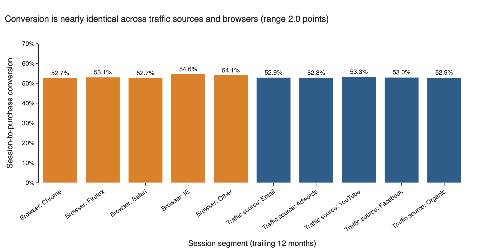

The funnel shows that the cart-to-purchase step loses about as many sessions as the view-to-cart step, but it offers no segment to target.

### Customers who never become customers

Source: `04_customer_purchase_groups.csv`

Of 100,000 registered users, 19,966 have never placed an order and a further 14,065 have placed only orders that were cancelled or returned. That leaves 34,031 users (34.0%) who have generated no revenue.

## 3. Customer value and repeat behavior

### Most customers buy once

Source: `05_orders_per_customer.csv`, `06_days_between_purchases.csv`

| Valid orders | Customers | Share of customers | Share of revenue |
|---|---|---|---|
| 1 | 46,097 | 69.9% | 49.6% |
| 2 | 14,031 | 21.3% | 30.1% |
| 3 | 4,273 | 6.5% | 13.6% |
| 4 | 1,568 | 2.4% | 6.7% |

The repeat purchase rate is 30.1%. The 19,872 repeat customers generate 50.4% of revenue and are worth $204.08 each against $86.58 for a one-time buyer. Their average order value is the same ($86.01 against $86.58), so the difference is entirely the number of orders.

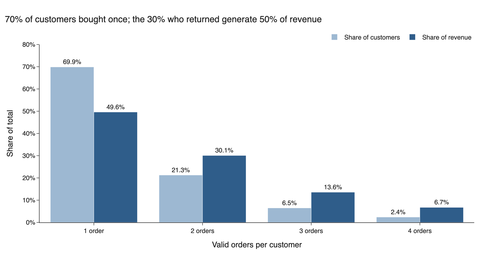

Repeat orders come slowly. The median gap between consecutive orders is 240 days (mean 393, interquartile range 74 to 568). Only 28.4% of repeat orders arrive within 90 days of the previous one and 61.9% within a year.

### Cohort retention

Source: `mart_cohort_retention`, `07_cohort_retention_by_year.csv`, `08_cohort_repeat_within_12_months.csv`

Customers are assigned to the month of their first valid order. Retention in month N is the share of the cohort placing a valid order in that month.

Monthly retention is low and flat within a cohort: there is no early peak followed by decay. For 2019 to 2022 cohorts it sits around 1% a month at every offset measured (0.5% to 1.3% at months 1, 3, 6, 12 and 24). It is higher for later cohorts: 2.3% to 2.6% for 2025 cohorts.

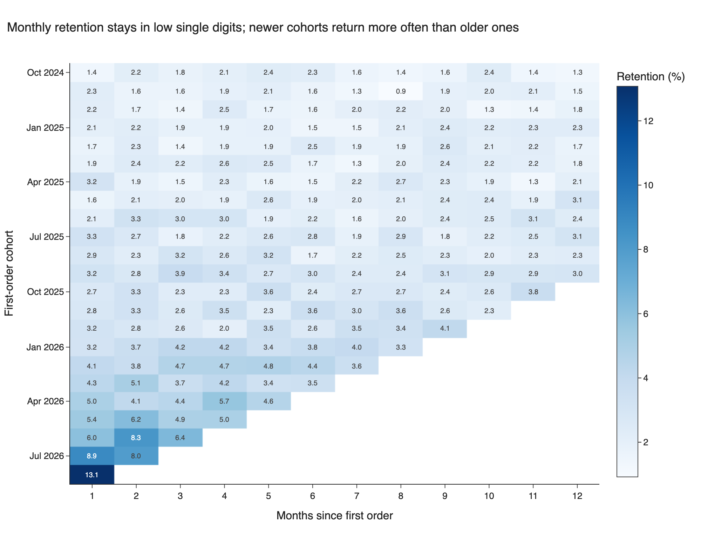

The share of a cohort placing a second order within 365 days, limited to customers with a full year of follow-up, rises steadily:

| First-order year | Customers | Second order within 90 days | Within 180 days | Within 365 days |
|---|---|---|---|---|
| 2019 | 737 | 2.6% | 4.8% | 8.3% |
| 2021 | 4,070 | 2.7% | 5.5% | 10.9% |
| 2023 | 8,026 | 3.5% | 6.9% | 13.4% |
| 2024 | 10,725 | 4.8% | 9.2% | 17.6% |
| 2025 (through September) | 10,563 | 7.0% | 12.9% | 22.5% |

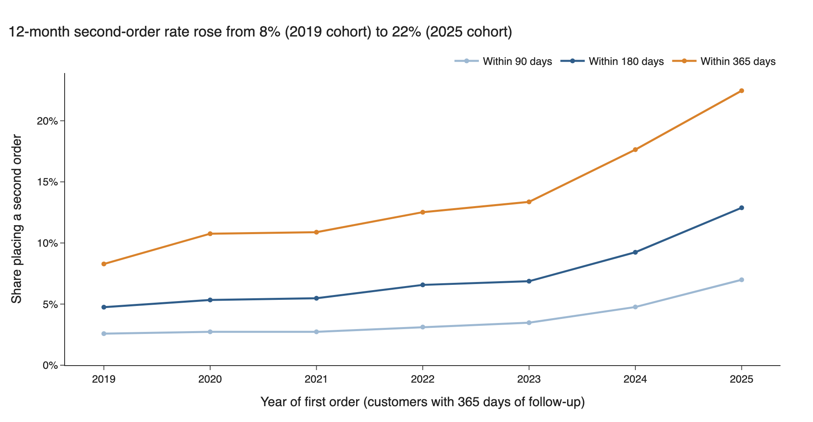

Newer cohorts do repeat sooner, but part of this is the dataset's concentration of orders near its end date (see `data_quality.md`, observation 7): any cohort whose follow-up window overlaps 2026 picks up more orders. The direction is reported as observed; the size should not be taken as evidence of an improving business.

### RFM segments

Source: `10_rfm_segments.csv`

| Segment | Customers | Share of customers | Revenue | Share of revenue | AOV | Avg orders | Median days since last order |
|---|---|---|---|---|---|---|---|
| High-Value At Risk | 9,141 | 13.9% | $2,000,383 | 24.9% | $143.12 | 1.53 | 1,037 |
| Champions | 7,657 | 11.6% | $1,990,551 | 24.7% | $101.77 | 2.55 | 87 |
| Potential Loyalists | 17,221 | 26.1% | $1,496,917 | 18.6% | $86.92 | 1.00 | 298 |
| Loyal | 7,027 | 10.7% | $1,059,885 | 13.2% | $66.65 | 2.26 | 321 |
| Lapsed | 15,711 | 23.8% | $713,142 | 8.9% | $45.39 | 1.00 | 1,141 |
| New Customers | 7,676 | 11.6% | $677,271 | 8.4% | $88.23 | 1.00 | 32 |
| At Risk | 1,536 | 2.3% | $108,319 | 1.3% | $33.82 | 2.09 | 944 |

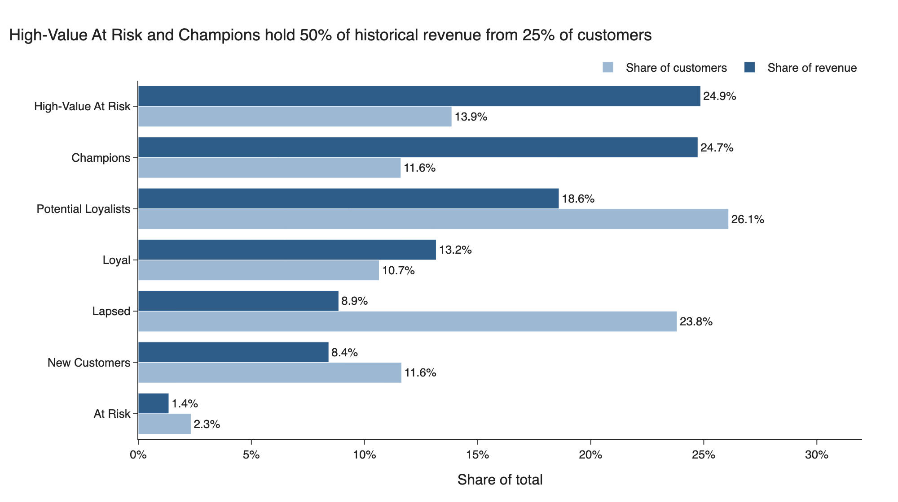

High-Value At Risk and Champions each hold about a quarter of historical revenue. On this view alone, High-Value At Risk looks like the obvious reactivation target: 9,141 customers with $218.84 average lifetime revenue who have not ordered in over 585 days. Section 5 tests that and does not support it.

### Revenue concentration

Source: `11_revenue_concentration.csv`, `mart_revenue_concentration`

| Top share of customers | Share of revenue | Minimum lifetime revenue in group |
|---|---|---|
| 1% | 6.4% | $587.82 |
| 5% | 21.0% | $364.86 |
| 10% | 33.9% | $276.37 |
| 20% | 52.5% | $189.49 |
| 50% | 83.6% | $79.95 |

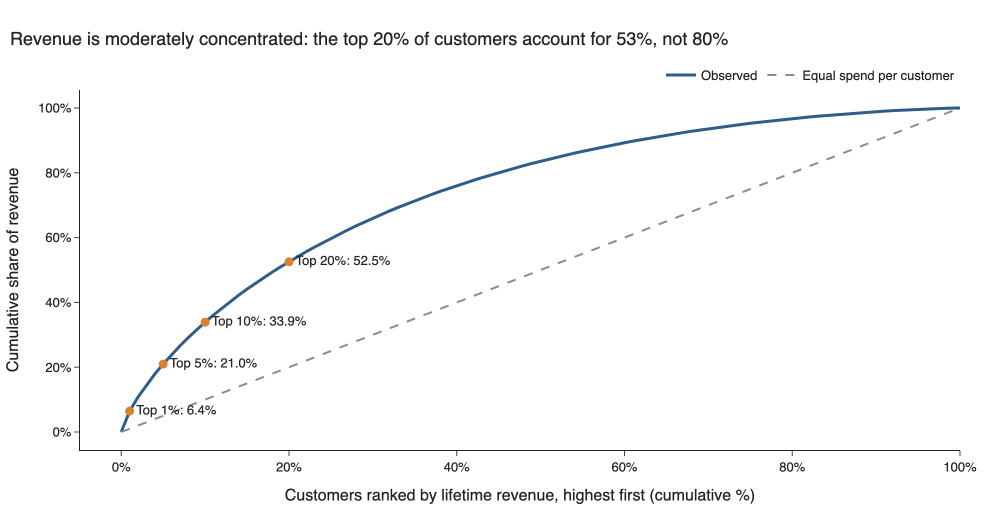

The data does not follow an 80/20 pattern. The top 20% of customers account for 52.5% of revenue; it takes roughly the top half to reach 80%. With at most four orders per customer and a narrow range of order values, no small group of customers dominates revenue.

## 4. Products and categories

Source: `17_category_performance.csv`, `18_category_revenue_trend.csv`

Revenue is spread across 26 categories; the top five account for 43.2% of revenue from 27.3% of units.

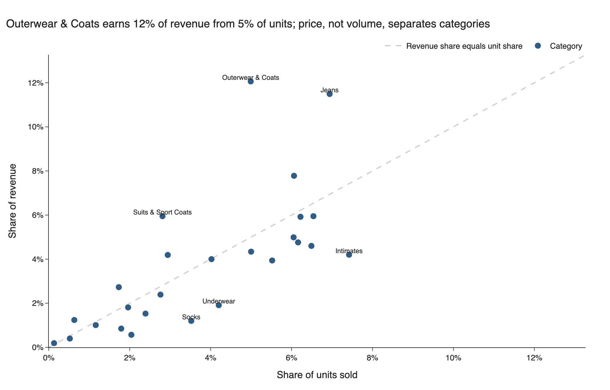

- **Price, not volume, separates categories.** Outerwear & Coats is the largest category by revenue (12.1%) on only 5.0% of units, at $143.58 per unit. Intimates is the largest by units (7.4%) but earns 4.2% of revenue at $33.63 per unit. Average unit revenue ranges from $16.69 to $143.58.
- **Leakage is proportional to revenue.** Because cancellation and return rates are flat, the dollars lost follow revenue: $328,984 in Outerwear & Coats and $323,329 in Jeans.
- **Margin does vary.** Gross margin on revenue ranges from 37.9% to 62.1%. Among the five largest categories, Suits & Sport Coats (59.8%) and Outerwear & Coats (55.6%) are well above Jeans (46.5%), so a dollar of Jeans revenue is worth less than a dollar of Outerwear revenue.
- **Growth is uneven beneath the total.** Revenue in the trailing 12 months was 97.7% above the prior 12 months overall. Jeans (+110.5%) and Intimates (+113.9%) grew faster than the total; Sweaters (+89.3%), Pants (+83.3%) and Sleep & Lounge (+82.0%) grew slower. Jeans is the fastest-growing of the five largest categories and has the lowest margin among them.
- **First purchase category does not predict repeat.** The share of customers who order again ranges from 28.5% to 32.6% by the category of their first order. No category works as an acquisition product that leads to more repeat purchasing.

## 5. Which customers to target for repeat revenue

Source: `mart_reorder_backtest`, `19_reorder_backtest.csv`, `20_reorder_backtest_recency_by_spend.csv`

RFM describes past value. To see what predicts a future order, customers were described as they stood on a snapshot date and followed for the next 365 days. The figures in this section use a snapshot of 2025-08-31 and an outcome window ending 2026-08-31, which leaves out the September 2026 spike in orders; section 7 compares this with the window that includes it. Of 41,192 customers with a valid order by the snapshot date, 16.2% ordered again in the window, at an average order value of $86.35.

| Customer attribute at snapshot | Customers | 12-month reorder rate | Value of next orders |
|---|---|---|---|
| Last order 0-90 days before | 5,240 | 23.1% | $85.39 |
| 91-180 days | 4,470 | 21.7% | $83.18 |
| 181-365 days | 7,385 | 18.4% | $87.83 |
| 366-730 days | 9,830 | 15.2% | $85.44 |
| Over 730 days | 14,267 | 11.4% | $88.78 |
| 1 prior order | 31,643 | 15.1% | $86.34 |
| 2+ prior orders | 9,549 | 19.7% | $86.37 |
| Top 40% by prior spend | 16,476 | 16.8% | $86.32 |
| Bottom 60% by prior spend | 24,716 | 15.7% | $86.37 |

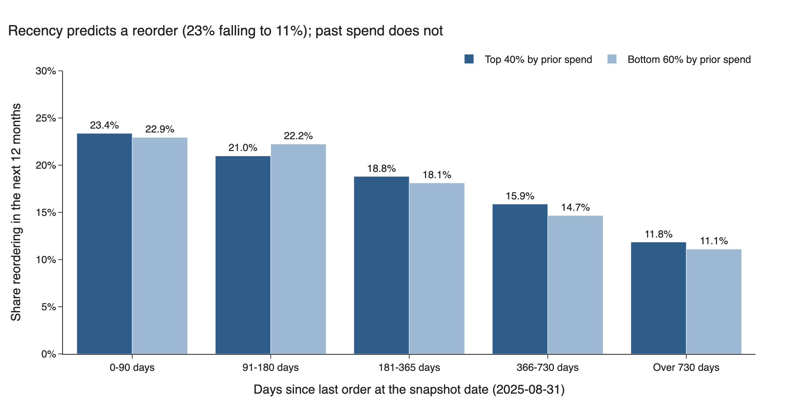

- **Recency is the strongest predictor.** The reorder rate halves from 23.1% for customers who bought in the last 90 days to 11.4% for those inactive for over two years.
- **A second order raises the chance of a third.** Customers with two or more prior orders reorder at 19.7% against 15.1% for one-order customers.
- **Past spend predicts almost nothing.** Within each recency band the top 40% and bottom 60% of spenders reorder at rates within about 1.3 points of each other, and in one band the lower spenders reorder more. Their next orders are worth the same ($86.32 against $86.37) even though their prior spend differs by more than a factor of four (about $202 to $220 against about $45). High historical spend in this data comes from having bought an expensive item once, not from a tendency to spend more.

This changes the reading of the RFM table. High-Value At Risk customers hold 24.9% of historical revenue, but customers like them (inactive over 730 days, top spend tier) reorder at 11.9% with a next-order value of $90.64, barely different from other long-inactive customers (11.1%, $87.69). Their past value does not carry forward, so they are not a better reactivation target than anyone else who has been inactive as long.

The larger opportunity is the 46,097 one-time buyers. They are 69.9% of customers, a second order raises both lifetime value and the chance of a third, and the ones most likely to respond are the 18,636 whose single order was in the last 365 days.

## 6. Estimated opportunity

Source: `mart_opportunity_scenarios`, `21_opportunity_scenarios.csv`, `22_opportunity_by_recency_band.csv`. Assumptions are in `dbt_project/seeds/scenario_assumptions.csv`.

Everything in this section is an **estimate** built on stated assumptions. None of it is revenue that has been generated. The baseline comes from the backtest window ending 2026-08-31.

**Model.** For each recency band:

`eligible one-time buyers x baseline 12-month reorder rate x assumed relative lift x expected order value`

| Input | Value | Type |
|---|---|---|
| Eligible customers | 46,097 customers with exactly one valid order | Observed |
| Baseline 12-month reorder rate | 10.8% to 22.4% by recency band (15.4% weighted) | Observed in the backtest for one-order customers |
| Expected order value | $86.34 | Observed in the backtest for one-order customers |
| Relative lift in reorder rate | 5%, 10%, 20% | Assumption |
| Incremental orders per reactivated customer | 1 | Assumption |

| Scenario | Assumed relative lift | Estimated additional customers reordering | Estimated incremental revenue, 12 months | Of which from buyers active in the last 365 days |
|---|---|---|---|---|
| Conservative | 5% | 355 | $30,622 | $16,401 |
| Base | 10% | 709 | $61,245 | $32,801 |
| Optimistic | 20% | 1,419 | $122,489 | $65,603 |

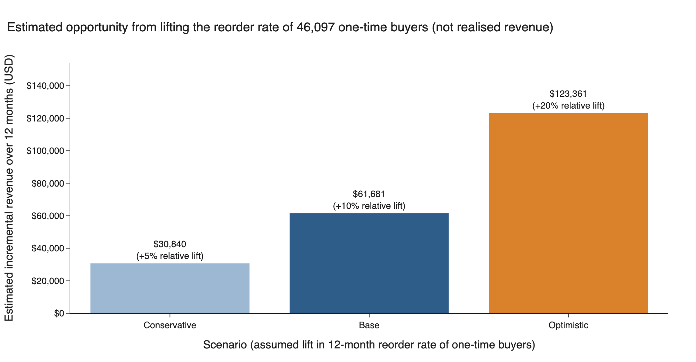

The base estimate is 1.9% of trailing-12-month revenue. Buyers whose order was in the last 365 days are 40% of the eligible population (18,636 of 46,097) but 54% of the estimate, because their baseline rate is higher.

Base scenario by recency band:

| Days since only order | Eligible customers | Baseline reorder rate | Estimated incremental revenue |
|---|---|---|---|
| 0-90 | 7,379 | 22.4% | $14,247 |
| 91-180 | 4,363 | 21.1% | $7,955 |
| 181-365 | 6,894 | 17.8% | $10,600 |
| 366-730 | 9,627 | 14.3% | $11,888 |
| Over 730 | 17,834 | 10.8% | $16,555 |

**For comparison.** One percentage point of trailing-12-month gross order value is $43,918. Reducing cancellations from 15.1% to 14.1% of gross order value would therefore be worth about as much as the base repeat-purchase scenario. This is a sensitivity, not a forecast: the data gives no indication of what would reduce cancellations.

## 7. Sensitivity to the September 2026 spike

Source: `25_final_month_sensitivity.csv`, `19_reorder_backtest.csv`

**The anomaly.** September 2026 has 9,956 orders placed against 5,621 in August, and its 7,466 valid orders are about a fifth of the trailing-12-month total. This is a property of the synthetic data. A backtest whose outcome window ends on 2026-09-30 counts those orders as reorders, which could inflate the baseline reorder rate and therefore the opportunity estimates.

**The original analysis** used a snapshot of 2025-09-30 and an outcome window ending 2026-09-30.

**The sensitivity test** moves both dates back one month: snapshot 2025-08-31, outcome window ending 2026-08-31. The window is still 365 days, so the two are comparable, and September 2026 is excluded entirely. Both versions are produced by `mart_reorder_backtest` and carried through `mart_opportunity_scenarios`.

| | Original (ends 2026-09-30) | Adjusted (ends 2026-08-31) |
|---|---|---|
| Customers at snapshot | 42,460 | 41,192 |
| Reorder rate, all customers | 16.3% | 16.2% |
| Reorder rate, one-order customers | 15.2% | 15.1% |
| Reorder rate, last order 0-90 days before | 24.2% | 23.1% |
| Reorder rate, last order over 730 days before | 11.4% | 11.4% |
| Reorder rate, top 40% by prior spend | 17.1% | 16.8% |
| Reorder rate, bottom 60% by prior spend | 15.8% | 15.7% |
| Next-order value, top 40% by prior spend | $87.24 | $86.32 |
| Next-order value, bottom 60% by prior spend | $85.21 | $86.37 |
| Baseline for eligible one-time buyers (weighted) | 15.6% | 15.4% |
| Expected order value | $85.78 | $86.34 |
| Conservative estimate | $30,840 | $30,622 |
| Base estimate | $61,681 | $61,245 |
| Optimistic estimate | $123,361 | $122,489 |

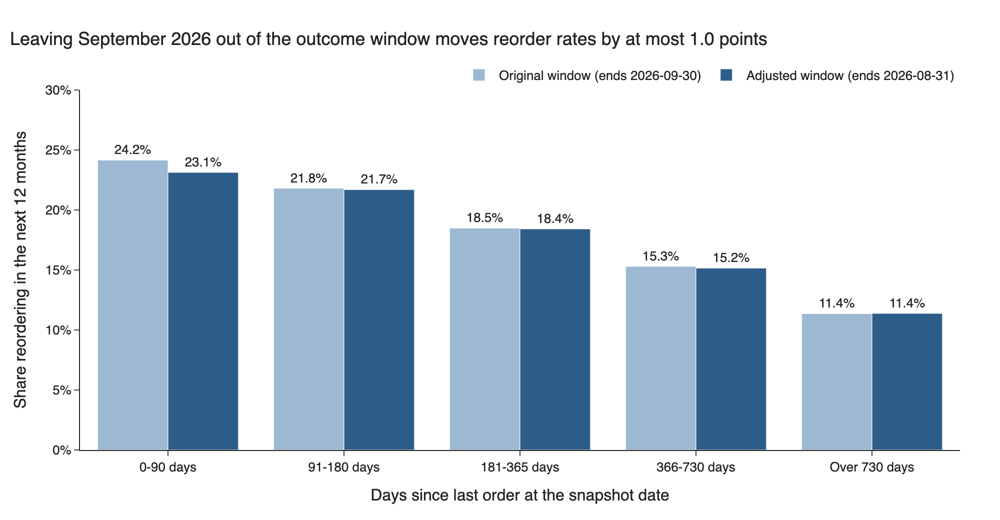

**Result.** The spike has a small effect. It raises the reorder rate of the most recently active customers by about one point (24.2% against 23.1%) and leaves the other recency bands within 0.1 points. The weighted baseline for one-time buyers moves from 15.6% to 15.4%, and the estimates fall by 0.7%.

**Recency relationship.** Unchanged. The rate still falls steadily across the five bands, from 23.1% to 11.4%.

**Spend-tier relationship.** Unchanged, and slightly weaker. The gap between spend tiers is 1.1 points in the adjusted window against 1.3 in the original, and the difference in next-order value disappears ($86.32 against $86.37).

**Does the recommendation change?** No. Recent one-time buyers remain the best-supported target in both windows. The adjusted window is used for the headline figures because it does not depend on the anomalous month.

**What this test does not address.** Order volume rises steeply throughout the final year, not only in September (monthly orders placed roughly double between February and August 2026). Removing one month does not remove that trend, so the baseline may still be above what a steady-state business would show.

## 8. Validation

Source: `23_validation_checks.csv`, dbt tests

- Revenue, valid orders, customers, repeat customers and purchase sessions were recalculated from the staging tables with independently written SQL and match the marts exactly (differences of zero).
- Revenue is identical at item, order, customer, month and category grain ($8,046,467.62), enforced by a dbt test, which rules out double counting from joins.
- Every customer appears in exactly one cohort and one RFM segment (65,969 in each), and cohort revenue sums to total revenue.
- The funnel uses sessions throughout as the denominator, requires each stage to follow the previous one in sequence, and a dbt test confirms stage counts never increase down the funnel.
- Cohort month zero is 100% for every cohort, enforced by a dbt test, and cohort offsets are only produced for months that have been observed.
