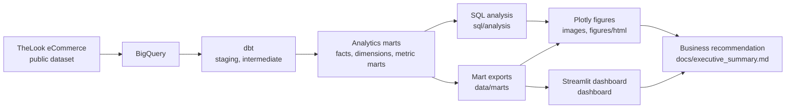
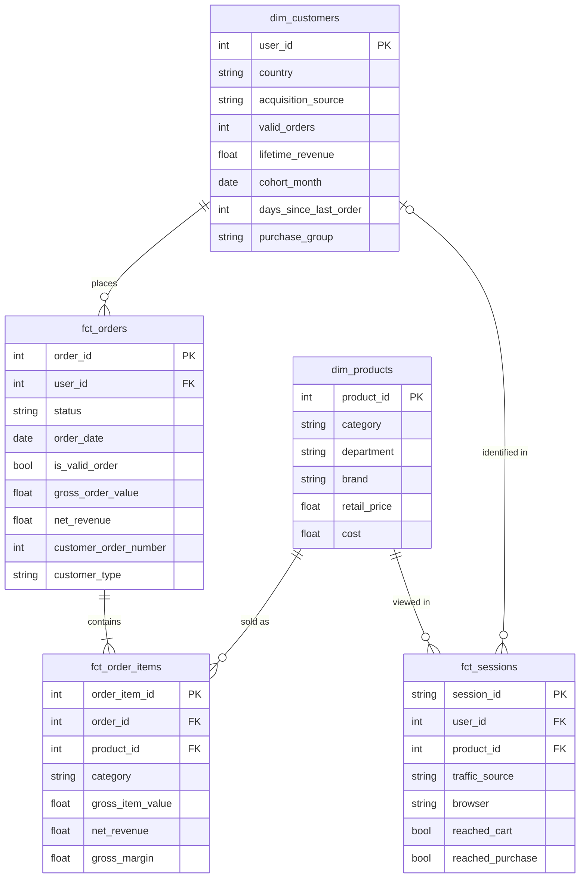

# Architecture

## Pipeline

1. **Source.** `bigquery-public-data.thelook_ecommerce`, read in place. Five tables are used: `users`, `orders`, `order_items`, `products`, `events`.
2. **dbt.** Builds 21 models and one seed into a `thelook_analytics` dataset.
3. **SQL analysis.** `scripts/run_sql.py` runs every file in `sql/profiling` and `sql/analysis` and writes one CSV per query to `analysis/outputs`.
4. **Exports.** `scripts/export_marts.py` writes nine mart tables to `data/marts`.
5. **Figures.** `figures/make_figures.py` reads only those CSVs and writes PNG and HTML figures. It contains no transformation logic.
6. **Dashboard.** `dashboard/app.py` is a Streamlit app that reads the mart exports. It needs no BigQuery connection.

## dbt layers

| Layer | Materialization | Purpose |
|---|---|---|
| Staging | Table | One model per source table. Renames columns, drops personal and unused fields, fixes minor inconsistencies. Materialized as tables so every downstream model reads the same copy of a source that changes daily, and so the 2.4M-row events table is scanned once per build. |
| Intermediate | View | Joins and rules shared by several marts: the revenue rule applied to items, order-level value, and session-level funnel flags. |
| Marts | Table | Facts, dimensions and reporting marts queried by the analysis, exports and figures. |

### Models

| Model | Grain | Primary key | Upstream | Purpose |
|---|---|---|---|---|
| `stg_users` | User | `user_id` | `users` | User attributes without personal fields |
| `stg_orders` | Order | `order_id` | `orders` | Order status and timestamps |
| `stg_order_items` | Order item | `order_item_id` | `order_items` | Item price and product |
| `stg_products` | Product | `product_id` | `products` | Catalog attributes |
| `stg_events` | Event | `event_id` | `events` | Web events with the product id parsed from the URI |
| `int_order_items_enriched` | Order item | `order_item_id` | `stg_order_items`, `stg_orders`, `stg_products` | Applies the revenue rule; adds order and product attributes |
| `int_orders_valued` | Order | `order_id` | `stg_orders`, `int_order_items_enriched` | Order value and revenue rolled up from items |
| `int_session_funnel` | Session | `session_id` | `stg_events`, `stg_orders` | Ordered funnel stage flags per session |
| `fct_orders` | Order | `order_id` | `int_orders_valued` | Order facts and the customer's purchase sequence |
| `fct_order_items` | Order item | `order_item_id` | `int_order_items_enriched` | Item facts for product and category analysis |
| `fct_sessions` | Session | `session_id` | `int_session_funnel`, `stg_products` | Session facts for the funnel |
| `dim_customers` | User | `user_id` | `stg_users`, `fct_orders` | User attributes and lifetime metrics |
| `dim_products` | Product | `product_id` | `stg_products` | Product attributes |
| `mart_monthly_revenue` | Month | `order_month` | `fct_orders` | Monthly KPIs with new and returning split |
| `mart_cohort_retention` | Cohort month x month offset | both | `fct_orders`, `dim_customers` | Retention matrix in long form |
| `mart_customer_rfm` | Customer | `user_id` | `dim_customers` | RFM scores and segment |
| `mart_revenue_concentration` | Customer percentile | `customer_percentile` | `dim_customers` | Cumulative revenue curve |
| `mart_funnel_summary` | Month x traffic source x browser x department x category | all five | `fct_sessions` | Funnel stage counts for reporting |
| `mart_category_metrics` | Department x category | both | `fct_order_items`, `fct_orders`, `dim_customers` | Category revenue, leakage, margin and repeat behavior |
| `mart_reorder_backtest` | Backtest window x recency band x prior order group x prior spend tier | all four | `fct_orders` | Observed 12-month reorder behavior, with and without the final month |
| `mart_opportunity_scenarios` | Backtest window x scenario x recency band | all three | `dim_customers`, `mart_reorder_backtest`, `scenario_assumptions` | Estimated incremental revenue |

The seed `scenario_assumptions` holds the assumed lift for each scenario. Two macros hold rules used in more than one model: `is_revenue_status` (which statuses count as revenue) and `recency_band`.

## Data model

`fct_orders` and `fct_order_items` are the transaction facts. `fct_sessions` is a separate fact that shares the product dimension; it joins to customers only for identified sessions and cannot be joined to orders, because the source gives no reliable key between a session and an order.

The reporting marts are aggregates of these facts and dimensions. They exist so that each metric is computed once in dbt and read, not recalculated, by the analysis queries, the figures and the dashboard.

## Tests

The build runs data tests alongside the models:

- `unique` and `not_null` on every primary key.
- `relationships` between facts and dimensions, and between staging tables, including the user and product keys on `fct_sessions`.
- `accepted_values` on order status, event type, traffic source, acquisition source, department, customer type, purchase group and RFM segment.
- Five singular tests in `dbt_project/tests`: revenue reconciles across item, order, customer, month and category grain; funnel stage counts never increase; each session views one product; composite keys are unique for all five marts with a composite grain; cohort month zero equals cohort size.

In total: 96 data tests (56 `not_null`, 17 `unique`, 9 `relationships`, 9 `accepted_values`, 5 singular).

## Dashboard

The Streamlit app has four pages: Executive Overview, Customer & Retention, Funnel & Product Performance, and Revenue Opportunity.

| File | Role |
|---|---|
| `dashboard/app.py` | Entry point and page navigation |
| `dashboard/data.py` | Cached loaders for the CSVs in `data/marts` |
| `dashboard/theme.py` | Shared chart styling and number formatting |
| `dashboard/views/` | One module per page |

The app filters and aggregates columns that the marts already provide (`net_revenue`, `is_valid_order`, `customer_type`, funnel stage counts, scenario estimates). Business rules such as the revenue definition, funnel stage ordering, RFM scoring and the scenario formula stay in dbt. On the Revenue Opportunity page the lift sliders rescale the estimates computed in `mart_opportunity_scenarios`; they do not recompute them from raw inputs.

## Cost

The project runs inside the BigQuery free tier. Staging selects only the columns used. The events table is scanned once per build, and every later model and query reads the materialized tables. The dbt profile and the Python client both cap a single query at 5 GB billed.
